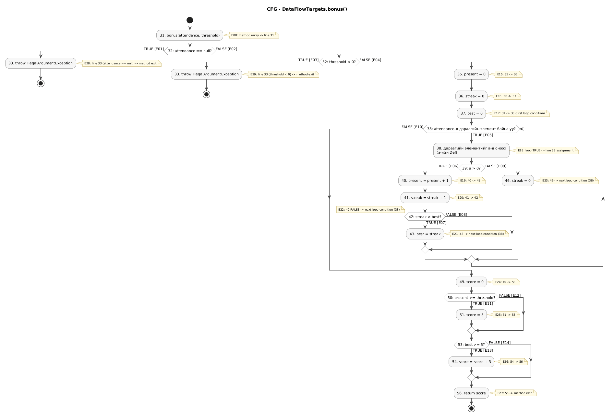
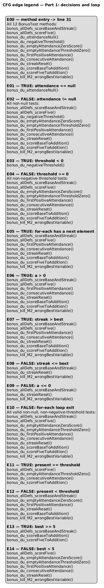
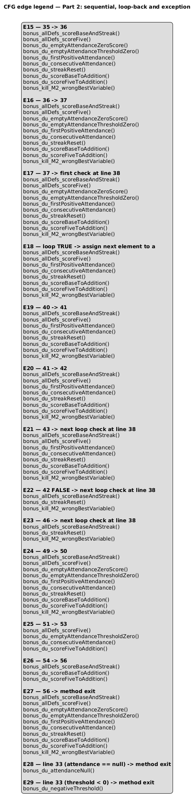

# Лаборатори №10 — Өгөгдлийн урсгалын тест

**Хичээл:** F.CSA313 — Программ хангамжийн чанарын баталгаа ба тест (2026)

## Оюутны мэдээлэл

- **Нэр:** Т.Оюунжаргал
- **Оюутны код:** B232270149

## Орчны мэдээлэл

### Java version

```text
java version "21.0.2" 2024-01-16 LTS
Java(TM) SE Runtime Environment (build 21.0.2+13-LTS-58)
Java HotSpot(TM) 64-Bit Server VM (build 21.0.2+13-LTS-58, mixed mode, sharing)
```

### Maven version

```text
Apache Maven 3.9.9 (8e8579a9e76f7d015ee5ec7bfcdc97d260186937)
Maven home: C:\Users\myagaa\Downloads\apache-maven-3.9.9-bin\apache-maven-3.9.9
Java version: 21.0.2, vendor: Oracle Corporation, runtime: C:\Program Files\Java\jdk-21
Default locale: en_US, platform encoding: UTF-8
OS name: "windows 11", version: "10.0", arch: "amd64", family: "windows"
```

---

# Хэсэг A — GCD Definition-Use анализ

## A1. Definition ба Use цэгүүд

GCD функцэд ашиглагдаж буй хувьсагч бүрийн Definition (Def) болон Use (C-use, P-use) цэгүүдийг тодорхойлов.

| Хувьсагч | Definition (мөр) | Use (мөр) |
|---|---|---|
| x | 13, 17 | 16 (C-use), 20 (C-use) |
| y | 13, 18 | 15 (P-use), 16 (C-use), 17 (C-use) |
| tmp | 16 | 18 (C-use) |

**Тайлбар:**

- **Definition (Def):** Хувьсагчид утга оноож байгаа цэг.
- **C-use:** Хувьсагчийн утгыг тооцоолол эсвэл илэрхийлэлд ашиглах.
- **P-use:** Хувьсагчийн утгыг нөхцөл шалгахад ашиглах.

## A2. GCD-ийн бүрэн DU хосууд

DU хос гэдэг нь тодорхойлолтоос (Def) хэрэглээний цэг (Use) хүртэл тухайн хувьсагч дахин тодорхойлогдоогүй (Def-clear) замаар холбогдсон хос юм.

| ID | Хувьсагч | Def мөр | Use мөр | Төрөл | Def-clear зам | Тестийн ID | Хамрагдсан эсэх |
|---|---|---:|---:|---|---|---|---|
| G1 | x | 13 | 16 | C-use | 13 → 15(T) → 16 | T2 | Тийм |
| G2 | x | 13 | 20 | C-use | 13 → 15(F) → 20 | T1 | Тийм |
| G3 | x | 17 | 16 | C-use | 17 → 18 → 15(T) → 16 | T2 | Тийм |
| G4 | x | 17 | 20 | C-use | 17 → 18 → 15(F) → 20 | T2 | Тийм |
| G5 | y | 13 | 15 | P-use (T) | 13 → 15(T) | T2 | Тийм |
| G6 | y | 13 | 15 | P-use (F) | 13 → 15(F) | T1 | Тийм |
| G7 | y | 13 | 16 | C-use | 13 → 15(T) → 16 | T2 | Тийм |
| G8 | y | 13 | 17 | C-use | 13 → 15(T) → 16 → 17 | T2 | Тийм |
| G9 | y | 18 | 15 | P-use (T) | 18 → 15(T) | T2 | Тийм |
| G10 | y | 18 | 15 | P-use (F) | 18 → 15(F) | T2 | Тийм |
| G11 | y | 18 | 16 | C-use | 18 → 15(T) → 16 | T2 | Тийм |
| G12 | y | 18 | 17 | C-use | 18 → 15(T) → 16 → 17 | T2 | Тийм |
| G13 | tmp | 16 | 18 | C-use | 16 → 17 → 18 | T2 | Тийм |

**Нийт: 13 DU хос.**

T = True, F = False.

## A3. JUnit тестүүд

Тестүүдийг `src/test/java/mn/edu/must/sqat/GcdTest.java` файлд хэрэгжүүлсэн.

### T1 — gcd(7, 0)

```java
@Test
@DisplayName("T1: G2, G6")
void gcd_7_0_zeroIterations() {
    assertEquals(7, DataFlowTargets.gcd(7, 0));
}
```

- Хүлээгдэж буй үр дүн: 7.
- `while` давталт 0 удаа ажиллана.
- `x`-ийн 13-р мөрийн definition нь 20-р мөрийн return-д хүрнэ.
- `y`-ийн 13-р мөрийн definition нь 15-р мөрийн False салаанд хүрнэ.
- G2 болон G6 DU хосыг хамарна.

### T2 — gcd(12, 8)

```java
@Test
@DisplayName("T2: G1, G3-G5, G7-G13")
void gcd_12_8_twoIterations() {
    assertEquals(4, DataFlowTargets.gcd(12, 8));
}
```

- Хүлээгдэж буй үр дүн: 4.
- `while` давталт 2 удаа ажиллана.
- Давталтын явцад `x` болон `y` хувьсагч дахин тодорхойлогдоно.
- `tmp` хувьсагчийн 16-р мөрийн definition нь 18-р мөрийн use-д хүрнэ.
- G1, G3, G4, G5, G7, G8, G9, G10, G11, G12, G13 DU хосыг хамарна.

## A4. DU хамралтын дүгнэлт

Хоёр тестийг хамтад нь ажиллуулснаар GCD функцийн нийт 13 DU хос бүгд хамрагдсан.

`gcd(7, 0)` тест нь давталт огт ажиллахгүй тохиолдлыг шалгаж, эхний definition-ээс давталтын дараах return болон `while` нөхцөлийн False салаанд хүрэх хосуудыг хамардаг.

`gcd(12, 8)` тест нь давталт хоёр удаа ажиллах нөхцөлийг шалгаж, хувьсагчдын дахин тодорхойлолт, дараагийн давталтын use болон давталт дуусах үеийн нөхцөлийг хамардаг.

Иймээс эдгээр хоёр тест нь GCD функцийн All-DU-Pairs хамралтыг хангаж байна.

## A5. Тестийн гүйцэтгэл

GCD функцийн DU хосуудыг шалгахын тулд `GcdTest.java` файлд T1 болон T2 гэсэн хоёр тест хэрэгжүүлсэн.

| Үзүүлэлт | Үр дүн |
|---|---:|
| Tests run | 2 |
| Failures | 0 |
| Errors | 0 |
| Skipped | 0 |
| Build | SUCCESS |

JaCoCo тайлангийн файлууд:

- `target/site/jacoco/index.html`
- `target/site/jacoco/jacoco.csv`

**Тайлбар:** JaCoCo нь кодын instruction, line болон branch хамралтыг хэмждэг. Харин DU-pairs хамралтыг гараар боловсруулсан DU хүснэгт болон JUnit тестүүдээр баталгаажуулсан.

---

# Хэсэг B — bonus() өгөгдлийн урсгалын шинжилгээ

## B1. bonus() Control Flow Graph

`bonus()` методын Control Flow Graph (CFG)-ийг үүсгэж,
кодын мөрийн дугаар болон тухайн салааг хамарсан тестийн методын нэрсийг тэмдэглэв.



**CFG салаануудын тестийн методын тайлбар:**





CFG нь методын гүйцэтгэлийн дараалал, нөхцөлт салаалал,
давталт болон тестүүдийн хамрах замыг харуулна.

## B2. Хувьсагчийн тодорхойлолт ба хэрэглээний жагсаалт (Definition-Use Listing)

### 1. Def/Use шинжилгээ

**Тодорхойлолт (Def):** Хувьсагчид шинэ утга оноож байгаа үйлдэл.

**Хэрэглээ (Use):** Хувьсагчийн утгыг уншиж ашиглаж байгаа үйлдэл.

| Мөр | Кодын үйлдэл | Definition (Def) | Use |
|---|---|---|---|
| 31 | Методын параметрүүд | attendance, threshold | — |
| 32 | Оролтын утгуудыг шалгах | — | attendance (P-use), threshold (P-use, attendance != null үед) |
| 33 | throw IllegalArgumentException | — | — |
| 35 | present = 0 | present | — |
| 36 | streak = 0 | streak | — |
| 37 | best = 0 | best | — |
| 38 | for (int a : attendance) | a | attendance (P-use: дараагийн элемент байгаа эсэх) |
| 39 | if (a > 0) | — | a (P-use) |
| 40 | present = present + 1 | present | present (C-use) |
| 41 | streak = streak + 1 | streak | streak (C-use) |
| 42 | if (streak > best) | — | streak (P-use), best (P-use) |
| 43 | best = streak | best | streak (C-use) |
| 46 | streak = 0 | streak | — |
| 49 | score = 0 | score | — |
| 50 | if (present >= threshold) | — | present (P-use), threshold (P-use) |
| 51 | score = 5 | score | — |
| 54 | score = score + 3 | score | score (C-use) |
| 56 | return score | — | score (C-use) |

### 2. Хэрэглээний төрлүүд

- **Def (Definition):** Хувьсагчид шинэ утга оноох үйлдэл.
- **C-use (Computational Use):** Хувьсагчийн утгыг тооцоолол, илэрхийлэл, оноолт эсвэл буцаах үйлдэлд ашиглах.
- **P-use (Predicate Use):** Хувьсагчийн утгыг нөхцөл шалгаж, програмын салааллыг тодорхойлоход ашиглах.

### 3. Чухал ажиглалтууд

1. 40-р мөр (`present = present + 1`) нь өмнөх утгыг уншиж, шинэ утга оноодог тул Def болон C-use хоёулаа болно.
2. 41-р мөр (`streak = streak + 1`) нь мөн өмнөх утгыг уншиж, шинэ утга оноодог тул Def болон C-use хоёулаа болно.
3. 43-р мөр (`best = streak`) нь `best` хувьсагчид шинэ утга оноож, `streak`-ийн утгыг ашиглана.
4. 46-р мөр (`streak = 0`) нь `streak`-ийн шинэ тодорхойлолт үүсгэж, өмнөх тодорхойлолтыг хүчингүй болгоно.
5. 38-р мөр нь enhanced for давталт бөгөөд `attendance` массивт дараагийн элемент байгаа эсэхийг шалгаж (P-use), тухайн элементийн утгыг `a` хувьсагчид онооно (Def).
6. 54-р мөр (`score = score + 3`) нь `score`-ийн өмнөх утгыг уншиж, шинэ утга оноодог тул Def болон C-use хоёулаа болно.
7. 32-р мөрөнд богино холболттой OR (`||`) оператор ашигласан тул `attendance == null` нөхцөл FALSE болсон тохиолдолд л `threshold < 0` нөхцөлийг шалгана.

## B3. Def-Clear DU хосуудын шинжилгээ

### 1. DU хосын тодорхойлолт

DU (Definition-Use) хос гэдэг нь хувьсагчийн тодорхойлолтоос (Def) тухайн хувьсагчийн хэрэглээ (Use) хүртэл өөр тодорхойлолтоор таслагдаагүй замаар хүрэх боломжтой хос юм.

**Def-clear зам** гэдэг нь тухайн хувьсагчийн Def-ээс Use хүртэл явахдаа уг хувьсагч дахин тодорхойлогдохгүй замыг хэлнэ.

P-use-ийн хувьд нөхцөлийн TRUE болон FALSE салааг тус тусад нь авч үзнэ.

### 2. DU хосуудын хүснэгт

Хүснэгт бүрд Def-clear зам болон тухайн замыг шалгах тестийн ID-г харуулав. Замын тэмдэглэгээнд `→` нь CFG-ийн дараалсан мөрүүдээр дамжихыг илэрхийлнэ.

#### 2.1 attendance

| ID | Definition | Use | Салаа | Def-clear path | Test ID | Төлөв |
|---|---|---|---|---|---|---|
| A1 | 31-р мөр | 32-р мөр (`attendance == null`) | TRUE | 31→32 | DP1 | Боломжтой |
| A2 | 31-р мөр | 32-р мөр (`attendance == null`) | FALSE | 31→32 | AD1, AD2, DP2–DP9 | Боломжтой |
| A3 | 31-р мөр | 38-р мөр (давталтын нөхцөл) | TRUE | 31→32→35→38 | DP5–DP9, AD1, AD2 | Боломжтой |
| A4 | 31-р мөр | 38-р мөр (давталтын нөхцөл) | FALSE | 31→32→35→38 | DP3, DP4 | Боломжтой |

#### 2.2 threshold

| ID | Definition | Use | Салаа | Def-clear path | Test ID | Төлөв |
|---|---|---|---|---|---|---|
| T1 | 31-р мөр | 32-р мөр (`threshold < 0`) | TRUE | 31→32 | DP2 | Боломжтой |
| T2 | 31-р мөр | 32-р мөр (`threshold < 0`) | FALSE | 31→32 | AD1, AD2, DP3–DP9 | Боломжтой |
| T3 | 31-р мөр | 50-р мөр (`present >= threshold`) | TRUE | 31→32→35→38→50 | DP4, DP6, DP9, AD2 | Боломжтой |
| T4 | 31-р мөр | 50-р мөр (`present >= threshold`) | FALSE | 31→32→35→38→50 | DP3, DP5, DP7, DP8, AD1 | Боломжтой |

#### 2.3 present

| ID | Definition | Use | Салаа | Def-clear path | Test ID | Төлөв |
|---|---|---|---|---|---|---|
| P1 | 35-р мөр | 40-р мөр (C-use) | — | 35→38→39→40 | DP5, DP6, DP7, DP8, DP9, AD1, AD2 | Боломжтой |
| P2 | 35-р мөр | 50-р мөр (P-use) | TRUE | 35→38(FALSE)→50 | DP4 | Боломжтой |
| P3 | 35-р мөр | 50-р мөр (P-use) | FALSE | 35→38(FALSE)→50 | DP3 | Боломжтой |
| P4 | 40-р мөр | 40-р мөр (C-use, дараагийн давталт) | — | 40→38→39(TRUE)→40 | DP6, DP8, DP9, AD1 | Боломжтой |
| P5 | 40-р мөр | 50-р мөр (P-use) | TRUE | 40→38→…→50(TRUE) | DP6, DP9 | Боломжтой |
| P6 | 40-р мөр | 50-р мөр (P-use) | FALSE | 40→38→…→50(FALSE) | DP5, DP7, DP8, AD1 | Боломжтой |

#### 2.4 streak

| ID | Definition | Use | Салаа | Def-clear path | Test ID | Төлөв |
|---|---|---|---|---|---|---|
| S1 | 36-р мөр | 41-р мөр (C-use) | — | 36→38→39(TRUE)→41 | DP5, DP6, DP7, AD1 | Боломжтой |
| S2 | 41-р мөр | 41-р мөр (C-use, дараагийн давталт) | — | 41→42→43→38→39(TRUE)→41 | DP6, DP8, DP9, AD1 | Боломжтой |
| S3 | 41-р мөр | 42-р мөр (P-use) | TRUE | 41→42(TRUE) | DP5, DP6, DP8, DP9, AD1 | Боломжтой |
| S4 | 41-р мөр | 42-р мөр (P-use) | FALSE | 41→42(FALSE) | DP7 | Боломжтой |
| S5 | 41-р мөр | 43-р мөр (C-use) | — | 41→42(TRUE)→43 | DP5, DP6, DP8, DP9, AD1 | Боломжтой |
| S6 | 46-р мөр | 41-р мөр (C-use, дараагийн давталт) | — | 46→38→39(TRUE)→41 | DP7, AD1 | Боломжтой |

#### 2.5 best

| ID | Definition | Use | Салаа | Def-clear path | Test ID | Төлөв |
|---|---|---|---|---|---|---|
| B1 | 37-р мөр | 42-р мөр (P-use) | TRUE | 37→38→39(TRUE)→41→42(TRUE) | DP5 | Боломжтой |
| B2 | 37-р мөр | 42-р мөр (P-use) | FALSE | — | — | Боломжгүй |
| B3 | 37-р мөр | 53-р мөр (P-use) | TRUE | — | — | Боломжгүй |
| B4 | 37-р мөр | 53-р мөр (P-use) | FALSE | 37→38(FALSE)→50→53(FALSE) | DP3, DP4 | Боломжтой |
| B5 | 43-р мөр | 42-р мөр (P-use) | TRUE | 43→38→39(TRUE)→41→42(TRUE) | DP6 | Боломжтой |
| B6 | 43-р мөр | 42-р мөр (P-use) | FALSE | 43→46→38→39(TRUE)→41→42(FALSE) | DP7 | Боломжтой |
| B7 | 43-р мөр | 53-р мөр (P-use) | TRUE | 43→38→…→50→53(TRUE) | DP8, DP9 | Боломжтой |
| B8 | 43-р мөр | 53-р мөр (P-use) | FALSE | 43→38→…→50→53(FALSE) | DP6, DP7 | Боломжтой |

#### 2.6 score

| ID | Definition | Use | Салаа | Def-clear path | Test ID | Төлөв |
|---|---|---|---|---|---|---|
| SC1 | 49-р мөр | 54-р мөр (C-use) | — | 49→50(FALSE)→53(TRUE)→54 | DP8, AD1 | Боломжтой |
| SC2 | 49-р мөр | 56-р мөр (C-use) | — | 49→50(FALSE)→53(FALSE)→56 | DP3, DP7 | Боломжтой |
| SC3 | 51-р мөр | 54-р мөр (C-use) | — | 51→53(TRUE)→54 | DP9 | Боломжтой |
| SC4 | 51-р мөр | 56-р мөр (C-use) | — | 51→53(FALSE)→56 | AD2 | Боломжтой |
| SC5 | 54-р мөр | 56-р мөр (C-use) | — | 54→56 | DP9 | Боломжтой |

#### 2.7 a

| ID | Definition | Use | Салаа | Def-clear path | Test ID | Төлөв |
|---|---|---|---|---|---|---|
| E1 | 38-р мөр | 39-р мөр (`a > 0`) | TRUE | 38→39(TRUE) | DP5, DP6, DP8, DP9, AD1, AD2 | Боломжтой |
| E2 | 38-р мөр | 39-р мөр (`a > 0`) | FALSE | 38→39(FALSE) | DP7, AD1 | Боломжтой |

### 3. Kill шинжилгээ

`streak` хувьсагчийн өгөгдлийн урсгалд 41 болон 46-р мөрүүд дахин тодорхойлолт үүсгэж, өмнөх Def-ийг хүчингүй болгох (Kill) боломжтой.

**46-р мөрийн код:**

```java
streak = 0;
```

Энэ үйлдэл нь `streak` хувьсагчид шинэ утга оноож, өмнөх тодорхойлолтыг хүчингүй болгоно.

| Өмнөх Def | Kill мөр | Нөлөө |
|---|---|---|
| 36-р мөр | 46-р мөр | Эхний `streak = 0` тодорхойлолтыг шинэчилнэ. |
| 41-р мөр | 46-р мөр | Ирц тасарсан үед өмнөх streak утгыг 0 болгож шинэчилнэ. |
| 46-р мөр | Дараагийн 46-р мөр | Өмнөх 46-р мөрийн тодорхойлолтыг шинэчилнэ. |

**Def-clear замгүй тул DU хосод тооцохгүй хослолууд**

| Definition | Use | Kill / Redefinition мөр | Шалтгаан |
|---|---|---|---|
| 36-р мөр | 42-р мөр | 41-р мөр | 42-р мөрд хүрэхээс өмнө 41-р мөр `streak`-ийг дахин тодорхойлно. |
| 36-р мөр | 43-р мөр | 41-р мөр | 43-р мөрд хүрэхээс өмнө 41-р мөр `streak`-ийг дахин тодорхойлно. |
| 46-р мөр | 42-р мөр | 41-р мөр | Дараагийн эерэг ирцийн үед 41-р мөр ажиллаж, 42-р мөрөөс өмнө `streak`-ийг дахин тодорхойлно. |
| 46-р мөр | 43-р мөр | 41-р мөр | Дараагийн эерэг ирцийн үед 41-р мөр ажиллаж, 43-р мөрөөс өмнө `streak`-ийг дахин тодорхойлно. |

Эдгээр дөрвөн хослол нь Use-д хүрэхээс өмнө `streak` дахин тодорхойлогддог тул Def-clear замгүй. Иймээс боломжтой DU хосын тоонд оруулахгүй.

**Дүгнэлт:** 41-р мөр нь `streak`-ийн өмнөх утгыг ашиглахын зэрэгцээ шинэ утга тодорхойлдог. Харин 46-р мөр нь `streak`-ийг 0 болгож, өмнөх тодорхойлолтыг хүчингүй болгодог. Эдгээр хоёр мөрийн нөлөөг ялгаж үзсэнээр DU хосын Def-clear нөхцөлийг зөв тодорхойлно.

### 4. Биелэшгүй P-use салаанууд

Дараах хоёр P-use салаа биелэх боломжгүй:

| Хувьсагч | Definition | Use | Биелэшгүй салаа | Үндэслэл |
|---|---|---|---|---|
| best | 37-р мөр | 42-р мөр | FALSE | Эхний эерэг ирцийн үед streak = 1, best = 0 болох тул нөхцөл заавал TRUE байна. |
| best | 37-р мөр | 53-р мөр | TRUE | best 5 буюу түүнээс их болохын тулд 43-р мөрөөр шинэчлэгдэх шаардлагатай тул 37-р мөрийн тодорхойлолт хүрэх боломжгүй. |

### 5. Нэгтгэл

| Хувьсагч | Боломжтой DU хос | Биелэшгүй салаа |
|---|---:|---:|
| attendance | 4 | 0 |
| threshold | 4 | 0 |
| present | 6 | 0 |
| streak | 6 | 0 |
| best | 6 | 2 |
| score | 5 | 0 |
| a | 2 | 0 |
| **Нийт** | **33** | **2** |

**Дүгнэлт**

`bonus()` методын өгөгдлийн урсгалын шинжилгээгээр нийт 33 боломжтой DU хос тодорхойлогдлоо. Үүнээс гадна `best` хувьсагчийн анхны тодорхойлолттой холбоотой хоёр P-use салаа биелэх боломжгүй тул DU хосын тоонд оруулаагүй. Мөн `streak` хувьсагчийн дөрвөн def-use хослол нь 41 болон 46-р мөрүүдийн дахин тодорхойлолтоор таслагддаг учраас Def-clear замгүй гэж үзэн хассан. Ялангуяа 46-р мөрийн `streak = 0` үйлдэл нь өмнөх `streak` тодорхойлолтыг хүчингүй болгож, дараагийн хэрэглээнд хүрэх боломжийг хязгаарладаг. Ийнхүү зөвхөн Def-clear замтай, бодитоор хэрэгжих боломжтой DU хосуудыг тооцоонд оруулсан.

## B4. All-Defs болон All-DU-Pairs тестийн үр дүн

### B4.1 All-Defs тестүүд

All-Defs хамрах хүрээг хангахын тулд `BonusTest.java` файлд хамгийн багадаа 2 тест хэрэгжүүлсэн.

| Тестийн ID | Методын нэр | Зорилго | Хүлээгдэж буй үр дүн |
|---|---|---|---:|
| AD1 | `bonus_allDefs_scoreBaseAndStreak` | Ирц тасарсан болон дараалсан ирцийн тохиолдол, score-ийн 49 ба 54-р мөрийн тодорхойлолтуудыг шалгах | 3 |
| AD2 | `bonus_allDefs_scoreFive` | score-ийн 51-р мөрийн тодорхойлолтыг шалгах | 5 |

**Хамгийн бага тестийн тооны үндэслэл:**

`score` хувьсагч нь 49, 51, 54-р мөрүүдэд тодорхойлогддог. Нэг гүйцэтгэлд 51-р мөр ажиллавал 49-р мөрийн тодорхойлолтыг шинэчилж, өмнөх утгыг хүчингүй болгоно. Иймээс 49-р мөрийн тодорхойлолтыг дараагийн хэрэглээнд хүргэхийн тулд 51-р мөрийг алгасах тест шаардлагатай. Харин 51-р мөрийн тодорхойлолтыг хэрэглээнд хүргэхийн тулд уг мөрийг ажиллуулах өөр тест шаардлагатай. Тиймээс бүх тодорхойлолтыг хамруулах хамгийн бага тоо нь 2 тест юм.

**Maven тестийн үр дүн**

| Үзүүлэлт | Үр дүн |
|---|---:|
| Нийт тест | 4 |
| Амжилттай | 4 |
| Алдаатай | 0 |
| BUILD | SUCCESS |

**JaCoCo үзүүлэлт**

| Үзүүлэлт | Covered | Missed |
|---|---:|---:|
| Instruction | 73 | 8 |
| Branch | 14 | 2 |
| Line | 22 | 2 |
| Complexity | 8 | 3 |
| Method | 2 | 1 |

Үр дүнг `results/mvn-verify-alldefs.txt` болон `results/jacoco-alldefs.csv` файлуудад хадгалсан.

### B4.2 All-DU-Pairs тестүүд

All-DU-Pairs хамралтыг хангахын тулд `GcdTest.java` болон `BonusTest.java` файлууд дахь тестүүдийг хамтад нь ажиллуулсан.

Энэ шатанд:

- GCD функцийн DU хосуудыг шалгах 2 тест;
- `bonus()` методын DU хосуудыг шалгах 11 тест;
- Нийт 13 тест ажиллуулсан.

**JaCoCo үзүүлэлт**

| Үзүүлэлт | Covered | Missed |
|---|---:|---:|
| Instruction | 78 | 3 |
| Branch | 16 | 0 |
| Line | 23 | 1 |
| Complexity | 10 | 1 |
| Method | 2 | 1 |

**Тайлбар:**

All-DU-Pairs тестүүдийн дараа 16 branch бүгд хамрагдсан. Нэг line хамрагдаагүй үлдсэн нь implicit default constructor-той холбоотой.

Үр дүнг дараах файлуудад хадгалсан:

- `results/mvn-verify-alldupairs.txt`
- `results/jacoco-alldupairs.csv`

## B5. Эцсийн JaCoCo coverage

Эцсийн `mvn clean verify` ажиллуулсны дараа JaCoCo тайланг шалгав.

| Үзүүлэлт | Утга |
|---|---:|
| Instruction missed | 3 |
| Instruction covered | 78 |
| Branch missed | 0 |
| Branch covered | 16 |
| Line missed | 1 |
| Line covered | 23 |

`BRANCH_MISSED=0`, `BRANCH_COVERED=16` тул `bonus()` методын бүх 16 branch бүрэн хамрагдсан. `LINE_MISSED=1` нь классын implicit default constructor-той холбоотой бөгөөд энэ нь лабораторийн шаардлагын дагуу нэмэлт тест шаардахгүй. Иймээс B5-ийн branch coverage шаардлага бүрэн хангагдсан.

### All-Defs ба Branch Coverage-ийн харьцуулалт

`jacoco-alldefs.csv` тайлангаас харахад All-Defs тестүүдийн дараа 14 branch хамрагдаж, 2 branch хамрагдаагүй байсан. Өөрөөр хэлбэл branch coverage нь 14/16 буюу 87.5% байв. All-Defs нь хувьсагчийн тодорхойлолт бүрээс дор хаяж нэг use-д хүрэх замыг хамруулахыг шаарддаг боловч шийдвэр бүрийн бүх боломжит үр дүнг шалгахыг заавал шаарддаггүй. Иймээс All-Defs хангагдсан ч branch coverage 100% болохгүй байж болно.

All-DU-Pairs тестүүдийг нэмсний дараа `jacoco-final.csv` тайланд 16/16 branch хамрагдаж, `BRANCH_MISSED=0` болсон. Гэхдээ Branch Coverage 100% болсон нь дангаараа бүх DU хос хамрагдсаныг батлахгүй. Жишээлбэл, `score` хувьсагчийн 49-р мөрийн тодорхойлолтоос 54-р мөрийн хэрэглээнд хүрэх `(49,54)` буюу SC1 нь бодит Def-clear DU хос юм. Энэ хосыг хамруулахын тулд 50-р мөрийн нөхцөл FALSE, 53-р мөрийн нөхцөл TRUE байх замаар гүйцэтгэх шаардлагатай. Манай DP8 болон AD1 тестүүд уг хосыг хамруулсан. Харин зөвхөн Branch Coverage-ийн 16/16 үзүүлэлтээс энэ DU хос хамрагдсан эсэхийг мэдэх боломжгүй. Иймээс Branch Coverage болон DU-Pairs Coverage-ийг тус тусад нь шинжлэх шаардлагатай.

Энэ харьцуулалт нь All-Defs, Branch Coverage болон All-DU-Pairs нь өөр өөр хамралтын шалгуур болохыг харуулж байна.

---

# Хэсэг C — Fault Seeding: Урсгалын алдаа тарих

## C1. Мутацийн тестийн үр дүн

`DataFlowTargets.java` файлд заасан гурван мутацийг нэг нэгээр нь хийж, мутаци бүрийн дараа эх кодыг `git restore` командаар сэргээж тестлэв. Мутацитай эх кодыг Git-д commit хийгээгүй.

| № | Мутаци | Төрөл | Тестийн үр дүн |
|---|---|---|---|
| M1 | `streak = streak + 1;` мөрийг устгах | Missing update | 13 тестээс 3 failure |
| M2 | `best = streak;` → `best = present;` | Wrong variable | 13 тест бүгд PASS |
| M3 | `int total = present + best;` мөр нэмэх | Dead definition | 14 тест бүгд PASS |

## C2. M1 — Missing update

`streak = streak + 1;` мөрийг устгаж туршихад дараах 3 тест амжилтгүй болсон.

| Унасан тест | Expected | Was |
|---|---:|---:|
| `bonus_allDefs_scoreBaseAndStreak` | 3 | 0 |
| `bonus_du_scoreBaseToAddition` | 3 | 0 |
| `bonus_du_scoreFiveToAddition` | 8 | 5 |

**Дүгнэлт:**

`streak` хувьсагчийн утга нэмэгдэхгүй болсноор дараалсан ирцийн тоо зөв тооцогдохгүй. Үүний улмаас `best` хувьсагч шинэчлэгдэхгүй, `best >= 5` нөхцөл биелэхгүй болж нэмэлт 3 оноо олгогдоогүй. Иймээс дээрх гурван тест M1 мутацийг амжилттай илрүүлсэн.

## C3. M2 — Wrong variable

`best = streak;` мөрийг `best = present;` болгон өөрчилж туршихад эхний 13 тест бүгд амжилттай ажилласан.

**Яагаад All-DU-Pairs тестүүд M2-ийг барьж чадаагүй вэ?**

All-DU-Pairs тестүүд хувьсагчийн тодорхойлолт болон хэрэглээний хосуудыг хамруулсан боловч хувьсагчид оноогдож буй утга зөв эсэхийг бүх боломжит нөхцөлд шалгаагүй. Өмнөх тестүүдэд `best` шинэчлэгдэх үед `present` болон `streak`-ийн утгууд мутацийн алдааг илрүүлэхүйц ялгаагүй байсан.

**M2-ийг илрүүлэх нэмэлт тест:**

`bonus_kill_M2_wrongBestVariable()` тестийг нэмсэн.

```java
@Test
@DisplayName("M2 kill: present >= 5 but best < 5")
void bonus_kill_M2_wrongBestVariable() {
    assertEquals(0, DataFlowTargets.bonus(
            new int[]{1, 1, 0, 1, 1, 1}, 6
    ));
}
```

Энэ тестээр зөв кодын үр дүн `0` байх ёстой. Харин M2 мутацитай үед `best = present = 5` болж, буруу үр дүн `3` гарсан.

| Тест | Expected | Was |
|---|---:|---:|
| `bonus_kill_M2_wrongBestVariable` | 0 | 3 |

Ингэснээр нэмэлт тест M2 мутацийг амжилттай илрүүлсэн.

## C4. M3 — Dead definition

Давталтын дараа `int score = 0;` мөрийн өмнө дараах кодыг нэмсэн.

```java
int total = present + best;
```

`total` хувьсагчид утга оноосон боловч программын цаашдын үйл ажиллагаанд ашиглаагүй.

**Тестийн үр дүн:**

- Нийт тест: 14
- Амжилтгүй: 0
- Амжилттай: 14
- Build: `BUILD SUCCESS`

Функциональ тестүүд программын гаралтыг шалгадаг тул ашиглагдаагүй хувьсагчийн тодорхойлолтыг илрүүлээгүй.

**Static Analysis — IDE warning:**

VS Code-ийн Java language support дараах анхааруулгыг гаргасан.

```text
The value of the local variable total is not used
Java(536870973) [Ln 49, Col 13]
```

**Дүгнэлт:**

M3 нь тестийн үр дүнд нөлөөлөхгүй боловч кодын чанарын асуудал үүсгэж байна. Ийм төрлийн ашиглагдаагүй хувьсагчийг static analysis болон IDE-ийн code inspection хэрэгслээр илрүүлэх боломжтой.

## C5. Эцсийн эх код ба verification

Бүх мутацийн туршилтын дараа эх кодыг дараах командаар сэргээсэн.

```powershell
git restore src/main/java/mn/edu/must/sqat/DataFlowTargets.java
```

`Select-String` командаар `int total` мөр байхгүйг шалгаж, `git status` командаар `DataFlowTargets.java` өөрчлөгдөөгүйг баталгаажуулсан.

Эцсийн шалгалтыг дараах командаар ажиллуулсан.

```powershell
mvn clean verify
```

**Эцсийн Maven үр дүн:**

| Үзүүлэлт | Үр дүн |
|---|---:|
| BonusTest | 12 passed |
| GcdTest | 2 passed |
| Нийт тест | 14 |
| Failures | 0 |
| Errors | 0 |
| Skipped | 0 |
| Build | BUILD SUCCESS |

**Эцсийн JaCoCo үр дүн:**

| Үзүүлэлт | Missed | Covered |
|---|---:|---:|
| Instructions | 3 | 78 |
| Branches | 0 | 16 |
| Lines | 1 | 23 |
| Complexity | 1 | 10 |
| Methods | 1 | 2 |

Branch coverage нь 100% буюу 16/16 болсон. `LINE_MISSED = 1` нь Java-аас автоматаар үүсгэсэн implicit constructor тул хэвийн үзэгдэл юм.

Эцсийн үр дүнг `results/mvn-verify-final.txt` болон `results/jacoco-final.csv` файлуудад хадгалсан.

---

# Ерөнхий дүгнэлт

Энэхүү лабораторийн ажлаар GCD болон `bonus()` методууд дээр өгөгдлийн урсгалын тестийн шинжилгээ хийж, Definition-Use болон DU хосуудыг тодорхойлсон. GCD функцийн хувьд нийт 13 DU хосыг хоёр тестээр хамруулсан бол `bonus()` методын хувьд 33 боломжтой DU хосыг тодорхойлж, биелэх боломжгүй хоёр P-use салааг тусад нь авч үзсэн. All-Defs болон All-DU-Pairs шалгуурыг хэрэгжүүлж, JaCoCo ашиглан branch болон line coverage-ийн үр дүнг харьцуулсан. Branch coverage нь нөхцөл бүрийн салааллыг шалгадаг бол DU тест нь хувьсагчийн тодорхойлолтоос хэрэглээ хүртэлх өгөгдлийн урсгалын зөв байдлыг шалгадаг тул илүү нарийвчилсан шинжилгээ хийх боломж олгодог. Гэхдээ DU хосуудыг гараар тодорхойлох, Def-clear зам болон биелэх боломжгүй салаануудыг шинжлэх нь нэмэлт цаг, хүчин чармайлт шаарддаг. Мутацийн тестээр Missing update алдаа болон Wrong variable алдааг илрүүлэхэд нэмэлт тестийн ач холбогдлыг харуулсан бол Dead definition алдааг IDE-ийн static analysis анхааруулгаар илрүүлсэн. Энэ лабораторийн ажлын хамгийн их цаг шаардсан хэсэг нь `bonus()` методын DU хосуудыг шинжилж, тэдгээрийг хамруулах тестүүдийг боловсруулах болон мутацийн үр дүнг шалгах ажил байв.

